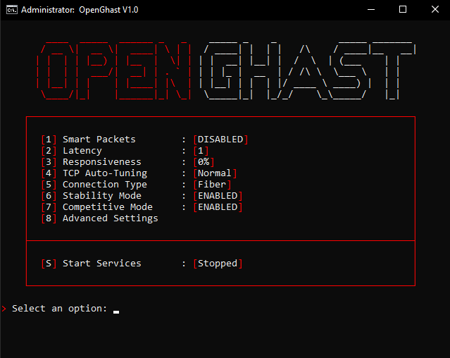

> [!WARNING]
> **Use at your own risk.** OpenGhast modifies Windows networking, service, and process settings. It is provided as-is, without warranty.

> [!NOTE]  
> **OpenGhast creates automated restore backups before applying changes.**
> **You can revert to Windows stock defaults anytime with `[S] Stop Services` or Advanced Settings `[8] -> [N] -> [3]`.**

  
  
  
  
  

---

## 👻 About OpenGhast

**OpenGhast** is an open-source, low-latency network optimizer for Windows written in 100% native Batch script.

Built as a lightweight, transparent, and completely free alternative to Ghast.io, OpenGhast tunes Windows TCP/IP networking, MMCSS system responsiveness and process priority without requiring external runtimes, PowerShell dependencies, or background resource overhead.

---

## 🔨 Installation

1. Download **[`OpenGhast.bat`](https://github.com/id7mgh/OpenGhast/releases/latest/download/OpenGhast.bat)** from the latest release.
2. Right-click **`OpenGhast.bat`** and select **Run as administrator**.
3. Customize your network profiles or press **`[S]`** to immediately start optimizing services.

---

## 🖥️ Interface Preview

  

---

## 📄 License

This project is licensed under the **Common Public Attribution License 1.0 (CPAL-1.0)**.
See the [LICENSE](LICENSE) file for details.
